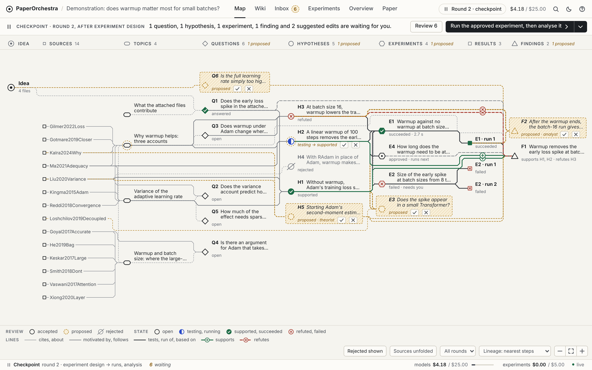

# <div align="center">🎻 PaperOrchestra</div>
<div align="center"><b>From an idea to a research wiki: sources, hypotheses, experiments, findings, and a paper if you want one.</b></div>
<br>

You describe an idea in a few sentences and attach whatever you already have. Agents research it and fill a wiki: what the literature says, the questions it leaves open, hypotheses worth testing, experiments that could test them, what the runs produced and what that means. They only suggest. Every page they write is a proposal until you accept it, as it is or with your edits, or reject it (their journal of each round aside), and no experiment runs until you approve that run. When the wiki says what you want to say, it can be written up as a paper.

<div align="center">
  
</div>

PaperOrchestra began as a multi-agent framework for writing AI research papers from an idea and an experimental log ([Song et al., 2026](#citation)). That pipeline is still here, as the optional last step of a project and [on its own](#writing-a-paper-directly).

## What you get

- **One place to put an idea.** A text box and any files: notes, data, figures, papers, code. No required file names or formats.
- **A wiki as the product.** Linked Markdown pages of ten kinds (idea, questions, sources, topics, hypotheses, experiments, results, findings, journal, lessons) in a plain directory you can read, edit and put under version control.
- **You decide, the agents suggest.** Proposals wait in a review inbox. Accept, edit then accept, or reject with a reason the agents read before they propose again. A change to a page of yours arrives as a suggested edit, shown in the text.
- **Experiments that really run, when you say so.** Small Python scripts on your machine, GPU jobs on [Modal](https://modal.com), or a command in a copy of your own repository. Each run needs your approval, and it starts only while the experiment is still what you approved: the same code, run the same way, on the backend and with the time limit and network access you chose.
- **Nothing invented.** Sources are verified against Semantic Scholar and written by code. Result records are written by code from the files a run produced. The numbers in a finding are looked for in the metrics of the runs, the sources and your files, and flagged where they occur in none.
- **Rounds with checkpoints.** The agents work one phase at a time and pause for you after each: research, hypotheses, experiment design, runs and analysis.
- **A web app with several views of the same wiki**: a map from the idea to the findings, the wiki itself, the review inbox, the experiments, and an overview with live activity and spending.
- **Claude Fable 5.2 by default**, with an API key or keyless Workload Identity Federation. Budgets for model spend and compute are enforced.

## Installation

PaperOrchestra is managed with [uv](https://docs.astral.sh/uv/) and needs Python 3.11 or newer.

```bash
uv sync --extra ui                 # the research workspace and its web app
uv sync --extra ui --extra modal   # the same with Modal, for GPU experiments and sandboxed runs
uv sync --all-extras               # everything, including Gemini and OpenAI providers
```

Each of these installs exactly the extras it names and removes the others.

Copy `.env.example` to `.env`, fill in what you use, and check the setup:

```bash
cp .env.example .env
uv run paper-orchestra doctor
```

`doctor` reports which credential the model provider will use (never the secret itself), whether TeX and Modal are available, and where memory is stored. The research agents need a Claude model (they work through the memory tool); see [Models and authentication](#models-and-authentication). On a fresh install without credentials `doctor` says so and exits 1; the demonstration and the app below work without them.

## Quick start

See the app first, without any model call or credential:

```bash
uv run paper-orchestra research demo        # builds ./research/demo-warmup (a second run: demo-warmup-2)
uv run paper-orchestra ui                   # prints the app's link and opens it in your browser
```

The demonstration project is a small study of learning-rate warmup. Its experiment runs are real (a few seconds of numpy on your machine, with their logs, metrics and figures); its pages and activity were written by hand and say so. Without a model, Continue there runs the approved experiment on your machine and then pauses, saying that the analysis needs one; nothing else in the app needs a credential.

Start a project of your own in the app with **New project**, or from the command line:

```bash
uv run paper-orchestra research new notes.md runs.csv loss.png \
  --brief "Warmup is said to matter most for large batches. I suspect that with adaptive optimisers it is small batches that need it."
```

This creates `./research/<name>/`, reads what you gave, researches prior work and stops at the first checkpoint. From there:

```bash
uv run paper-orchestra research status  <project>             # where it stands, what waits for you
uv run paper-orchestra research review  <project>             # list what is waiting
uv run paper-orchestra research review  <project> --accept H1 --reject H3 --reason "Not testable here"
uv run paper-orchestra research advance <project>             # the agents work to the next checkpoint
uv run paper-orchestra research review  <project> --accept E1 # accept an experiment's plan ...
uv run paper-orchestra research approve <project> E1          # ... and approve one run of it
uv run paper-orchestra research advance <project>             # runs what you approved, then analyses it
uv run paper-orchestra research request <project> "Also look at schedule-free optimisers" --for scout
uv run paper-orchestra research decide  <project>             # what the agents ask you to choose
uv run paper-orchestra research decide  <project> 1 --option 2 --say "and keep the first as a fallback"
uv run paper-orchestra research cancel  <project> E1          # stop a run, or take an approval back
```

`<project>` is the project's directory, its name under `./research`, or its id. What these commands do, the web app does too, and both can be used on the same project at the same time.

## How a project works

### The wiki

A project is a directory; its `wiki/` holds one Markdown page per thing:

| Kind | Where | Written by | What it is |
|---|---|---|---|
| idea | `wiki/idea.md` | you | The idea, the root of everything else. |
| question | `wiki/questions/Q1-….md` | agents, you | One open question. `open`, `answered` or `dropped`. |
| source | `wiki/sources/Kingma2015Adam.md` | code | One verified paper: metadata, abstract, link. Read-only for agents. |
| topic | `wiki/topics/….md` | agents, you | What is known about one subject, with the sources it rests on. |
| hypothesis | `wiki/hypotheses/H1-….md` | agents, you | One falsifiable claim with its predictions. `open`, `testing`, `supported`, `refuted`, `inconclusive`, `dropped`. |
| experiment | `wiki/experiments/E1-….md` | agents, you | The plan of one experiment; its code is under `experiments/E1/code/`. |
| result | `wiki/results/E1-run1.md` | code | What one run produced: metrics exactly as written, the log's last lines, artifacts. |
| finding | `wiki/findings/F1-….md` | agents, you | What a result means, and which hypothesis it supports or refutes. |
| journal | `wiki/journal/round-1.md` | agents, you | A short account of each round; a note of your own, such as a decision and its reason. |
| lesson | `wiki/lessons/….md` | you | Something about how to work on this project that the agents should keep in mind in later rounds. |

Pages point at each other with typed relations in their front matter (`cites`, `about`, `answers`, `motivated_by`, `tests`, `run_of`, `based_on`, `supports`, `refutes`, `follows`) and with `[[links]]` in their text. Those relations are the map.

**Review.** Every page has a review state. What an agent writes is `proposed` until you decide; what you write is accepted. Editing is not deciding: a proposal you correct stays a proposal, with your corrections in it, until you accept it. Rejected pages are kept with your reason, and agents are shown the title and the reason only, so that the same thing is not proposed again. An agent cannot change a page you wrote, edited or accepted: it proposes an edit, which you read in place and accept or turn down, again with a reason it gets to read. Earlier versions of every page are kept under `history/`.

Which kinds need your review is a setting (`review` in `project.json`): by default sources and journal pages are accepted as they come, everything else an agent writes waits for you.

**What agents build on.** An agent works from the accepted pages. Of the pages of its own kinds that still await your decision it is told the titles and summaries, so that it neither repeats a proposal nor builds on one. The one exception is the scout that runs right after intake, which can read intake's pages before you have, marked as not yet reviewed. A source you delete is not recorded again; to have it back, leave a request that names the paper.

**The number check.** The specific numbers in a finding's title, summary and text are looked for in the metrics of runs that succeeded (of experiments you did not reject), in the accepted sources and in your files. The finding's page and the checkpoint say which were not found, and which were found only outside the records the finding is based on. Short and round numbers are not checked. It is a check of occurrence: it says that a number is on record, not that it is the number the sentence is about.

### Rounds and checkpoints

| Phase | Agent | What happens | Then |
|---|---|---|---|
| intake | intake | Reads the idea and the attached files (text, images, PDFs); writes what each contributes and the questions it raises, and names a project you gave no title. | goes on |
| research | scout | Finds prior work with web search. Each paper is verified against Semantic Scholar and its record written by code. Writes topic syntheses and the questions the literature leaves open. | checkpoint |
| hypothesize | theorist | Proposes hypotheses with predictions an experiment could contradict. | checkpoint |
| design | designer | Proposes experiments with their code for the hypotheses you accepted. The code is parsed and checked, never run. | checkpoint |
| run | runner | Runs the experiments you approved. A run that fails for a programming error is repaired, a bounded number of times, each repair recorded with its diff. | goes on |
| analyze | analyst | Writes findings from the result records, proposes verdicts on hypotheses as edits for you to accept, proposes next steps, writes the round's journal. | checkpoint, next round |

At a checkpoint nothing happens until you say so. You can edit any page, add pages of your own, decide what was proposed, and leave an instruction ("also look at schedule-free optimisers"). An instruction is for one role (scout, theorist, designer, analyst), and then given to that role's next phase, or for all four, and then shown to each of their phases until the round's analysis is done.

`research advance`, and **Continue** in the app, first runs what you approved and analyses results that have no analysis yet. If anything ran, it stops at the checkpoint after that analysis, and the phase that was next stays next. Otherwise it goes on with that phase. `--phase` starts with the phase named instead (intake then goes on to research, a run to its analysis). A run you cancelled is not analysed. Where no model can be used, what you approved still runs, without repairs, and the call pauses after it with one sentence about what to set up; if there is nothing to run, `advance` says that sentence and exits with 3.

A round after the first begins with hypotheses. Another look at the literature is your choice: `research advance --phase research`, or "Search the literature again" in the list beside Continue in the app. The analyst can recommend one in the round's journal, and the checkpoint after the analysis repeats the recommendation. An instruction for the scout waits for that phase, and every checkpoint says so.

### Decisions the agents ask of you

Some questions no source and no run settles, because the answer is your choice: which reading of your idea is meant, what exactly is to be studied, whether a wider scope is worth its cost. An agent that meets one asks you with a **decision**: the question in one sentence, why it matters, two to five options, the one it would take and why, and the default it goes on with. The project does not wait for your answer. The agents continue with the default and write so that the other answer can still be taken, and the next checkpoint says how many decisions wait.

- **In the app** the open decisions are the first thing in the Inbox and are counted on its tab. Each option is a button; you can also answer in your own words, alone or together with an option, or say "Not for me to decide", which leaves it to the agents and their default. What you answered is listed below the proposals, folded, and can be answered again: the new answer holds and the earlier ones are kept with their times. The page a decision is about says how it stands.
- **On the command line** `research decide <project>` lists what waits. `research decide <project> D --option N`, `--say "..."` or both answer the decision `D` (its id, or its number in the list), and `--dismiss` leaves it to the agents. `research status` counts the open ones.
- **The agents** are shown, in every session of every role and for as long as the project lives, what waits (so that it is not asked twice), what you answered and what you left to them. An instruction is forgotten once its phases have run; an answer is not. They can only ask: at most three decisions per phase, none while twelve already wait, and nothing an agent is given answers or changes a decision. A question page that already says "the researcher has to decide" is raised as a decision by the next agent that reads it.

A decision is one file, `decisions/d-<id>.json`: the question, the options, who asked in which round and phase, and every answer you gave. Options are numbered from 1 everywhere.

A phase that fails is retried once. Stopping the agents (the Stop button, Ctrl-C where `research advance` runs, or `kill -INT` of the worker) ends the phase before its next model request and leaves it resumable: the same command continues it without writing anything twice.

### Experiments

An experiment is a page (objective, method, metrics and success criteria, resources) and code. Three modes:

| Mode | What runs | Where |
|---|---|---|
| `script` | Self-contained Python under `experiments/E1/code/`, run as `python main.py`. | Your machine, or a Modal sandbox. |
| `gpu` | The same, with a GPU and pip packages. | Modal. |
| `repo` | A command in a copy of your repository (`repo` in the project's settings), optionally with a patch the designer proposes. Your working tree is never touched, and copying it runs nothing the repository configures (no hooks, no filters). | Your machine, or Modal for a repository that is cloned. |

The contract of an experiment's code: write `metrics.json` (a flat object of numbers, true/false or short strings), put figures and tables under `artifacts/`, print progress, be deterministic given a seed. Only what the run itself writes counts as its result: a `metrics.json` or `artifacts/` that was there before is removed before the command starts and noted on the run.

**Approval.** Accepting an experiment's page accepts the plan. It runs only after you approve the run, in the app ("Accept and run", or the approval form) or with `research approve`, which says what it approved to run: the command, the code files, the packages, the backend, the time limit and the network setting (`research cancel` takes the approval back). The approval records a digest of the code and of how it runs. A run starts, or resumes after a crash, only while the experiment still has that digest; otherwise it is a plan again and says what changed. (The runner's repairs of a failed run are recorded with their diff and allowed.) One approval is one run. An approved experiment whose code or plan changed is listed as needing approval again and is not counted in what Continue will run.

Three things are never taken from the plan, which an agent may have written. The backend is the project's (Modal for a GPU) unless you choose another, at this approval or at an earlier one of the same experiment. The network is off unless you allow it, and a plan that asks for it must be answered either way. And an experiment becomes approved only through your approval, never by an edit of its page.

**Backends.** `local` runs the job as a subprocess in a throw-away copy, with credentials removed from its environment and a time limit. When the job ends, times out or is cancelled, its process group and session are killed and, on Linux, every process that still carries the job's mark in its environment (`PAPER_ORCHESTRA_JOB`). It is not a sandbox: a job runs as you, can read what you can read, can reach the network whatever the approval says, and uses the packages you have installed. `modal` runs each job in its own sandbox with the packages and GPU the plan asks for, no secrets, and no network unless you approved it. Use Modal for code you would not run on your machine.

**Records.** Each run keeps a copy of the code it ran, its full log, `metrics.json`, its artifacts and a `run.json`, under `experiments/E1/runs/<k>/`. The result page is generated from those files; the number check and the write-up read `run.json`, so editing a result page changes neither. Credentials the worker knows (its environment, a token in the repository's address) are replaced by `[redacted]` in logs, in what run records and result pages hold of the job's own words (log lines, errors, notes, the names of metrics and their text values), and in everything the app shows. Stopping the agents puts a run that is still going back in the queue; a run that had finished stays finished. Cancelling ends a run that is queued or running; for an approved experiment that has not started it takes the approval back, and the experiment is a plan again. If a worker is killed in the middle of a run, the next Continue, Run or Cancel ends what its job left running and removes its working directory.

**Limits** (`limits` in `project.json`, or the overview's "Change the limits"): `model_usd` is the total model spend of the research agents (default $25), `experiment_usd` the total estimated compute spend of all runs ($5), `experiment_seconds` the longest time limit one run may be given (900). Reaching a limit stops at a checkpoint that says which. The model budget is looked at before every session and turn and after every model request, so at most the one request that crossed it goes beyond; the phase resumes where it stopped once you raise the limit. Costs on Modal are estimates from list prices. A GPU type without a list price is not approved, because nothing could hold its run to the limit, and a run that was stopped or lost still counts for the time it ran.

### The web app

```bash
uv run paper-orchestra ui [--workspace DIR] [--port 8600] [--no-browser] [--stop-workers-on-exit]
```

The workspace is a directory of projects (default `./research`).

- **Map**: the wiki laid out from the idea to the findings. Proposals are drawn dashed and can be decided on the map; selecting a page traces what it rests on and what it led to.
- **Wiki**: every page, with an editor (live preview, history, restore), suggested edits marked in the text, and the number check on findings. Saving keeps a proposal open; "Save and accept" decides.
- **Inbox**: everything waiting for you, with the keyboard (`J`/`K`, `A` accept, `E` edit, `R` reject, `Z` undo). A suggested edit to a finding that brings a number found on no record is marked in the list. What the agents ask you to choose stands first, each option a button. On a phone it is the list, then one proposal with its answers at the foot of the screen.
- **Experiments**: plan, code, approval, runs with a live log, metrics and figures, and what to do about a failed or interrupted run.
- **Overview**: the checkpoint, the argument so far (each hypothesis with its experiments and findings), live activity, an instruction box, spending.
- **Paper**: the optional write-up.

**Access.** The server listens on your machine only (`127.0.0.1`) and still asks for an access token, because other users and programs on the same machine can reach a local port. Once it listens, `ui` prints one link that carries the token (`http://127.0.0.1:8600/?token=...`) and opens it in your browser; from then on a cookie holds it. With `--no-browser`, through `ssh -L`, or where the browser cannot read the file the server hands it (a browser installed as a snap or Flatpak), open the printed link yourself. Where the server's output goes to a file that other users can read, the link is not written there and the message says what to do. Every start makes a new token, and a tab left open says that it needs the new link. Set `PAPER_ORCHESTRA_UI_TOKEN` (16 characters or more) for the server's command to keep one token across restarts. A program sends `Authorization: Bearer <token>`.

Without the token nobody can read a project, change anything or start anything, and the token is on no command line, in no file of a project and in no worker's environment. Three things it does not keep out:

- Anything that runs as you. Experiments on the local backend do, and that backend is not a sandbox.
- A program that listens on another port of the machine your browser runs on. A browser sends a cookie to every port of a host, so such a program receives the token when your browser opens its address, and a link on any web page can lead it there. On a machine you share, keep the browser on your own computer and reach the app with `ssh -L`.
- Somebody on the network, if you pass `--host`: the token then travels unencrypted. Prefer `ssh -L`.

**Workers.** The agents and experiments of a project run in a process of their own, so closing the browser, Ctrl-C on the server or a closed terminal stops nothing and loses nothing: the server prints which workers keep running, and the next server finds them again. `--stop-workers-on-exit` stops them with the server instead. The app stops only a process it started or can show to be this project's worker. One it cannot verify, such as a worker on another machine that shares the directory, is shown without Stop.

Page text is rendered on the server with raw HTML disabled, the app loads nothing from the network, and it reads a project's files only inside the project directory, never through a link that leads out of it. A request may carry at most 8 MB; the files attached to a new project may have 50 MB each and 500 MB together.

### Writing it up

```bash
uv run paper-orchestra research write <project> --template cvpr2025
```

The paper pipeline is given only what you accepted: the idea and the hypotheses with their standing, the method of experiments that ran, metrics from the runs' own records, the accepted findings, accepted topic pages as background, and figures from run artifacts. The sources you accepted are the papers its literature review starts from, under the keys they have in the wiki and without being looked up again; a source you rejected is never cited; the pipeline's own search adds further verified papers. Text files and images you attached to the project are included as your own material, so a project built on results you brought can be written up without any run.

Proposed and rejected pages never reach a paper. A finding that rests only on a rejected experiment is left out and named, and a number in a finding that is on no record is replaced by "[a number not on record]". The write-up runs in `<project>/paper/` and takes the options of [`write`](#writing-a-paper-directly) for models, effort, research cutoff, plotting, compute, lab memory, dreaming and resume, each defaulting to the project's setting where it has one; its model spend is reported there and is not part of the research budget. The app's Paper view starts the same write-up with a bundled template and, if you name one, a single model for every role. Accepting or rejecting a source and starting the write-up again writes the paper again; starting it again with nothing changed resumes.

### The project directory

```
<project>/
  project.json     identity and settings (models, review policy, limits, your repository)
  state.json       where the engine is: round, phase, checkpoint, spending
  events.jsonl     the activity stream the app shows
  usage.json       model usage of the research agents, with its estimated cost
  inputs/          your idea and the files you attached, as given
  wiki/            the pages
  proposals/       suggested edits, pending and decided
  history/         earlier versions of pages
  requests/        your instructions to the agents
  decisions/       what the agents asked you to choose, and what you answered (made when the first one is asked)
  experiments/     code and runs of each experiment
  transcripts/     every model session, for checking what an agent actually saw and did
  notes/           kept for the memory harness the agents work through; the research agents write nothing here
  MEMORY.md        the index of the wiki that every agent session starts from, written by code
  paper/           the write-up, if you asked for one
```

Pages are plain Markdown with `key: value` front matter. You can edit them with any editor while no agent is running; `research status` and the app report what they had to guess in a hand-edited project. If `state.json` is lost or damaged, the project is not started over: where it stands is read from `events.jsonl`, both say so, and the engine writes the file again when it next works on the project. A copy of a project directory is a project of its own. A project in which `project.json`, `wiki/`, `inputs/`, `proposals/`, `requests/` or `transcripts/` is a symbolic link that leads out of the directory is not opened. Where `history/` or `experiments/` is such a link, nothing is read, written or run through it, and no paper is written through a linked `paper/`. No agent or experiment is started while a link stands in the place of `state.json`, `events.jsonl` or `usage.json`.

## Models and authentication

All agents, of the research workspace and of the paper pipeline, default to `claude-fable-5-2`. A project's models are set per role in its `project.json` (`models.research` for intake and the scout, `models.reasoning` for the theorist and the analyst, `models.coding` for the designer and the runner); the app's options for a new project set the reasoning effort, not the models. Two ways to authenticate:

**API key.** Set `ANTHROPIC_API_KEY`. The web app reads credentials when it starts: after setting one, stop `paper-orchestra ui` and start it again (the agents and experiments it started go on meanwhile).

**Workload Identity Federation (keyless).** Set the federation variables and provide an OIDC identity token from your platform:

```bash
ANTHROPIC_FEDERATION_RULE_ID=fdrl_...
ANTHROPIC_ORGANIZATION_ID=...
ANTHROPIC_SERVICE_ACCOUNT_ID=svac_...
ANTHROPIC_WORKSPACE_ID=wrkspc_...          # only if the rule spans several workspaces
ANTHROPIC_IDENTITY_TOKEN_FILE=/path/to/oidc-token
```

The token is exchanged for a short-lived access token and refreshed automatically. An `ANTHROPIC_API_KEY` or `ANTHROPIC_AUTH_TOKEN` in the environment takes precedence over federation, so unset them when you want federation; `doctor` warns when this happens. Identity tokens are usually single-use, so each process needs its own: for local batch runs with several worker processes use an API key, or fan out on Modal, where every container gets its own token.

A temporary failure of the token exchange (a network error, HTTP 408, 429 or 5xx) is retried with backoff and, if it persists, fails the stage as a retryable error. A denied exchange (400, 401, 403) stops the run as a configuration error; the reason is in the federation history of the Claude Console.

Claude Fable 5.2 requires an organization with data retention enabled. Requests the model declines are retried on a fallback model by the API (server-side fallbacks are enabled). A reply cut off at the default output limit is requested once more with the model's maximum. At `--effort xhigh` or `max` a full-paper reply can still exceed that; lower the effort if a stage fails with a truncation.

The research agents work through tools and the memory tool, which the Claude models have; with a model of another provider in one of those roles the engine refuses before it spends anything and says which role to change. The paper pipeline can use other providers: install the extra and pass the model name:

```bash
uv sync --extra gemini   # GEMINI_API_KEY, or VERTEX_AI_PROJECT + VERTEX_AI_LOCATION
uv sync --extra openai   # OPENAI_API_KEY
uv run paper-orchestra write ... --writer-model gemini-3.1-pro-preview
```

The Gemini and OpenAI clients have no memory tool, so they use the memory harness in "push" mode: the lessons and syntheses in memory are placed in the prompt instead of being opened on demand. Consolidation sessions, which write those pages, need a model with the memory tool. Keep a Claude model in the reflection role if you want the learning loop described under [Memory](#memory); without one, notes are kept but never turned into lessons.

`SEMANTIC_SCHOLAR_API_KEY` is optional but raises the rate limit of literature verification considerably.

## Compute backends

Three kinds of work leave the orchestrating process: experiments of a research project (see [Experiments](#experiments)), model-written Python that draws a paper's figures, and compiling model-written LaTeX. The table is about the last two.

| Backend | Figure code | LaTeX | Isolation |
|---|---|---|---|
| `local` | subprocess with a scrubbed environment, resource limits and a timeout | local `pdflatex`/`bibtex`, shell escape disabled, file access limited to the workspace | Keeps credentials out of the child's environment, but it is not a sandbox. |
| `modal` | Modal Sandbox, network blocked, no secrets | Modal Sandbox with TeX Live, network blocked | Nothing model-written runs on your machine. |

```bash
uv sync --extra modal
uv run modal setup
uv run paper-orchestra write ... --compute modal
```

Model-written LaTeX is screened before it is compiled, on every backend. A document that uses constructs which read or write files or run code (shell escape, `\openin`/`\openout`, `\pdfobj` file streams, absolute or parent paths in `\input` and `\includegraphics`, and similar) is not compiled; the reasons go back to the writer as errors to fix. The screen exists because TeX's own file-access limits do not cover every primitive. It is a filter, not a proof: for materials you do not trust, use `--compute modal`, where a document can reach nothing but its own workspace.

A backend that cannot work is reported before the first model call is paid for: missing TeX Live for `local`, a missing Modal token for `modal`. If a stage later fails while the backend reports itself unusable, the run stops with that message instead of retrying, and the same command resumes there once the environment is fixed.

### Running the whole pipeline on Modal

```bash
uv run paper-orchestra modal run \
  --raw-materials-dir path/to/raw_materials \
  --template cvpr2025 \
  --output-dir paper_output \
  --plotting
```

This is `modal run -m paper_orchestra.modal_app` underneath. The Modal commands must be run from a checkout of this repository with `uv sync --extra modal` (the image is built from `uv.lock`); from an installed wheel they fail with a message that says so. The command uploads the raw materials, runs the pipeline in a container, and downloads `final_paper.pdf`, `final_paper.tex` and `usage.json`. It takes the same model options as `write` (`--model`, `--writer-model`, ...); `paper-orchestra modal run --help` lists them, including `--run-id` to resume or re-download a run.

Outputs and the lab memory live on a Modal Volume (`paper-orchestra` by default), so a preempted or interrupted run resumes where it stopped. A run id is written by one call at a time: a second call for a run that is in flight is refused, and after a run was cancelled or its container killed the same run id can be refused for a couple of minutes, until its lease expires.

Nothing model-written runs next to a credential. Figure code and LaTeX both run in nested sandboxes with no network, no Secret and no identity token; one LaTeX sandbox serves a whole run. Set `PAPER_ORCHESTRA_MODAL_LATEX=local` when running or deploying to compile inside the pipeline container instead, which is faster and still screened as described above. The TeX images cover the bundled templates and common font packages; `PAPER_ORCHESTRA_MODAL_TEX_PACKAGES="pkg1 pkg2"` adds Debian packages for a template that needs more.

Runs on Modal only add their lessons to the lab memory as notes. A separate function, `consolidate_memory`, is the single writer that folds them into pages, because a Volume keeps the last write of each file.

#### Batches on Modal

```bash
uv run paper-orchestra modal deploy
uv run paper-orchestra modal batch \
  --root-input-folder datasets/cvpr2025/papers \
  --template cvpr2025 \
  --output-dir batch_output
```

Each paper is its own Modal call, downloaded and logged as soon as it finishes. Ctrl-C or a lost connection stops nothing on Modal: the papers are recorded in `paper_writing_log.json` as `submitted`, and running the same command again waits for them and collects the results (Modal keeps a result for seven days). `--cancel` stops the submitted papers instead. Each paper runs under `<paper id>-<8 hex digits>`, where the digits stand for the options and the template: the same batch submitted again resumes its runs, while another model, effort, option or template gets runs of its own, so batches that compare settings never return each other's papers.

#### Credentials on Modal

Credentials come from a Modal Secret (named `paper-orchestra` by default, `PAPER_ORCHESTRA_MODAL_SECRET` to change). Two setups are supported:

- **API key**: `modal secret create paper-orchestra ANTHROPIC_API_KEY=sk-ant-...` (add `SEMANTIC_SCHOLAR_API_KEY` if you have one).
- **Keyless**: Modal gives every function an OIDC identity token (issuer `https://oidc.modal.com`, audience `oidc.modal.com`), which is exchanged for short-lived Anthropic access tokens, so no Anthropic secret is stored anywhere. The container only needs the non-secret identifiers `ANTHROPIC_FEDERATION_RULE_ID` and `ANTHROPIC_ORGANIZATION_ID` (plus `ANTHROPIC_SERVICE_ACCOUNT_ID` / `ANTHROPIC_WORKSPACE_ID` if your rule needs them). Put them in the Secret, or export them in the shell that launches the run and set `PAPER_ORCHESTRA_MODAL_SECRET=none`. Do not also provide an API key: it would take precedence, and the run refuses to start when both are present.

The keyless setup could not be exercised against the live services while this was written, so check three things on the Anthropic side when you set up the federation rule. If the first exchange is refused, the error lists the claims of the container's token to compare against the rule.

1. The rule must admit both functions of the app, `write_paper` and `consolidate_memory`. Match on the Modal workspace and app name, or list both function names; a rule pinned to `write_paper` alone lets papers be written but never folds their lessons into the lab memory.
2. The issuer's maximum token lifetime must be at least the lifetime of Modal's identity tokens, which can be much longer than the one-hour default.
3. The access tokens the rule issues should live as long as a run can take (`PAPER_ORCHESTRA_MODAL_TIMEOUT`, six hours by default), because a single-use identity token cannot be exchanged a second time to renew them.

## Writing a paper directly

The paper pipeline also runs on its own, from materials you prepared: an idea and an experimental log. It turns them into a submission-ready LaTeX manuscript with a verified literature review and generated figures. A team of agents handles outline generation, literature review, plotting, section writing and content refinement, with per-stage retry and resume.

<div align="center">
  
</div>

```bash
uv run paper-orchestra write \
  --raw-materials-dir path/to/raw_materials \
  --template cvpr2025 \
  --output-dir paper_output \
  --plotting
```

Local LaTeX compilation needs TeX Live (`pdflatex` and `bibtex` on `PATH`). With `--compute modal` no local TeX install is required. An example of the two input files is in `examples/cvpr_example.json`.

`raw_materials/` contains:

| File | Purpose |
|---|---|
| `idea_sparse.md` | The method, contributions and framing (`--idea-filename` to change). |
| `experimental_log.md` | Raw results: tables, ablations, metrics (`--experimental-log-filename`). |
| `figures/` + `figures/info.json` | Optional ready-made figures, as `[{"name": "fig.png", "caption": "..."}]`. Used when running without `--plotting`. With `--plotting` every figure is generated and these are ignored, unless you pass `--keep-provided-figures`. |
| `known_papers.json` | Optional. Papers the bibliography starts from, which are not looked up again, and papers never to cite: `{"version": 1, "papers": [...], "excluded": [...]}`. `research write` produces it from the sources you accepted and rejected; without it nothing changes. A list or an entry that cannot be used is reported as a warning and never stops the run. |

`--template` takes the name of a bundled template (`cvpr2025`, `iclr2025`), or a path to your own template directory containing `template.tex` and `guidelines.md`. A name is also looked up under `$PAPER_ORCHESTRA_TEMPLATES` and `./templates`.

Useful options:

| Option | Default | Meaning |
|---|---|---|
| `--plotting / --no-plotting` | off | Generate figures from the outline's plotting plan. |
| `--keep-provided-figures` | off | With `--plotting`, also give the writer the figures in `raw_materials/figures`. |
| `--model` | `claude-fable-5-2` | Model for every role without a flag of its own. |
| `--writer-model`, `--reflection-model`, `--plotting-model` | `--model` | Model per role. |
| `--fast-model` | `--model`, else the writer model | Model for high-volume calls such as literature discovery (run at low effort). Discovery works best on a model with web search; pass this flag when the writer's provider has none. |
| `--image-model` | unset | Image-generation model for diagrams (for example a Gemini image model). When unset, diagrams are drawn from model-written plotting code. |
| `--effort` | `high` | Reasoning effort for the main calls. |
| `--research-cutoff` | current month | `YYYY-MM`; papers published later are not cited as prior work. |
| `--compute` | `local` | `local` or `modal`. |
| `--memory / --no-memory` | on | The wiki memory harness. |
| `--lab-memory / --no-lab-memory` | on | Share process lessons across papers. Turn off for benchmark runs. |
| `--dream` | `stages` | When memory is consolidated by a model: `off`, `end`, or `stages`. |
| `--resume / --no-resume` | on | Skip stages already completed in the output directory, while the inputs and the settings that shape the paper are unchanged (see [Outputs](#outputs-of-the-paper-pipeline)). |

The flag names of the original CLI (`--raw_materials_dir`, `--latex_template_dir`, `--use_plotting true`, ...) are still accepted.

## Memory

In a research project the wiki is the memory: agents read the accepted pages through the memory tool and write their proposals into it, and every session is recorded under `transcripts/`. The rest of this section describes the memory of the paper pipeline, which is built on the same harness.

Agents do not get everything stuffed into their prompt, and they do not start from zero each time. Every model call goes through a context harness whose memory is a wiki on disk:

| Layer | Where | Written by | Used for |
|---|---|---|---|
| Transcripts | `memory/transcripts/*.jsonl` | the harness, automatically | The record of what happened; notes are checked against it. |
| Notes | `memory/notes/*.md` | agents and pipeline code, during a stage | Salient observations: a failure and its cause, a decision and its reason. |
| Wiki pages | `memory/wiki/<section>/<page>.md` | pipeline code (records) and consolidation sessions (lessons, synthesis) | One page per thing, linked with `[[section/page]]`. |
| Index | `memory/MEMORY.md` | regenerated automatically; a few curated standing notes | Loaded into every session (capped at 200 lines / 25 KB). |

Between stages a separate consolidation session ("dreaming") verifies notes against the transcripts and sources, folds what holds up into pages, repairs links and keeps the index within budget. It archives only the notes it actually read; the rest wait for the next consolidation. Its pages may state only what this run's sources, bibliography and transcripts say, and it does not see the lab memory. The refinement loop uses this as a learning loop: each accepted or rejected revision is recorded with its score changes and turned into a rule the next iteration can see. A rejected revision is discarded and the remaining iterations start again from the last accepted version, now with that lesson (`retry_after_rejection`; the original behaviour of stopping at the first rejection is available by turning it off in `PipelineConfig`).

There are two memories:

- **Project memory** (`<output-dir>/memory`): everything about this paper. Sources are stored verbatim and are read-only ground truth.
- **Lab memory** (`~/.paper_orchestra/memory`, or `PAPER_ORCHESTRA_MEMORY_DIR` / `--lab-memory-dir`): persists across runs and holds only process lessons (LaTeX pitfalls, venue rules, which revisions helped). Runs read it and never rewrite it.

A lesson reaches the lab memory in two steps, so that the session maintaining it never sees a paper. First, pipeline code copies each lesson that a consolidation marked as portable into the lab as a note, but only if a mechanical scan finds nothing of the paper in it: no result-like number, no distinctive name (a method, dataset or system) and no run of wording from the paper's inputs, outline, figure captions, reviews or drafts. What the template directory ships (the template and guidelines) is the venue's and may be quoted; everything else in the run is the paper, including the template file once sections have been written into it. Nothing is shared when there is nothing to scan against. Second, a session that has only the lab memory in front of it folds those notes into pages; until then other runs cannot see them.

The scan is a filter on form. It stops lessons that carry their evidence along, in the spellings that occur in practice (a result as a percentage or rounded, a name in lower case or inside a file name). It does not stop a paraphrase, a number that was computed or rounded to an integer, or a name that is an ordinary capitalised word. `memory_report.json` says how many lessons a run shared and how many the scan kept back. Use `--no-lab-memory` for strict benchmark runs.

Beside the lab wiki, `cache/` keeps Semantic Scholar records across runs. It is read by pipeline code only: no model session can open or search it, and every cached record is checked against the current run's research cutoff before it is used.

Inspect and maintain a run's memory:

```bash
uv run paper-orchestra memory show   --run-dir paper_output
uv run paper-orchestra memory search --run-dir paper_output "undefined control sequence"
uv run paper-orchestra memory lint   --run-dir paper_output
uv run paper-orchestra memory dream  --run-dir paper_output
```

`memory dream` consolidates with the reflection model the run used (`--model` to override).

With Claude models the wiki is exposed through the native memory tool, so the model opens pages and writes notes itself. Reviewers and bulk calls never see memory.

## Outputs of the paper pipeline

Everything is written under `--output-dir` (for a research project's write-up: `<project>/paper/`):

| Path | Content |
|---|---|
| `final_paper.pdf`, `final_paper.tex` | The result. |
| `outline.json` | Plotting plan, literature search plan and section plan. |
| `literature_agent_output/` | `references.bib`, `citation_map.json`, the outline with citation candidates, the template with Introduction and Related Work written, and `collected_papers.json` (the verified papers, including the ones known beforehand, kept so that a retried literature stage does not search again). |
| `plotting_results.json`, `figures/` | Generated figures with captions and critic history. |
| `latex_writeup/` | The LaTeX workspace (`raw_draft_paper.tex`, figures, bibliography). |
| `content_refinement_workdir/` | Each revision, reviews, worklogs and page screenshots. |
| `memory/` | The project memory described above. |
| `state.json` | Per-stage status; drives resume. The literature stage's record carries its warnings and how many papers were known beforehand and how many candidates were excluded. |
| `usage.json`, `time_breakdown.json` | Token usage with an estimated cost (refreshed every few seconds while stages run), and time per stage. |
| `memory_report.json` | What the end-of-run consolidation did, including how many lessons were shared with the lab memory and how many were kept back. |

A failed stage is retried on its own; re-running the same command resumes from the last completed stage. Details worth knowing:

- **What restarts a run.** Resume applies while the inputs and the settings that shape the paper are unchanged: the models and efforts, plotting and its options, the refinement options, memory on or off (and, with memory on, lab memory and the dream mode), the input file names, and the list of known papers when the materials hold one. If one changes, a warning names it and every stage runs again in that directory, replacing the earlier paper, so use a new output directory to compare settings. The compute backend, timeouts, worker counts and a later research cutoff do not restart a run; the one exception is a later cutoff that lets in a known paper which had been left out as too recent.
- **Ctrl-C.** The run stops issuing model calls, waits up to ten seconds for literature and plotting when they run side by side, and records itself and the stopped stages as `interrupted` in `state.json`. The same command resumes it.
- **Plotting is optional.** If it fails, the paper is written without generated figures. Such a failure is tried again when the run is resumed, unless that run had already delivered its paper.
- **Refinement needs a review.** If the review of the draft fails (a provider outage, a rate limit), the refinement stage fails and is retried; it never passes the unrefined draft off as refined. An error in one refinement iteration costs that iteration only.

## Batch runs

```bash
uv run paper-orchestra batch \
  --root-input-folder datasets/cvpr2025/papers \
  --template cvpr2025 \
  --output-dir batch_output
```

Each paper gets its own output directory and is written in a worker process of its own (`--max-workers` at a time). `paper_writing_log.json` records the result per paper, and a re-run skips papers that already succeeded. If a worker dies, for example killed for using too much memory, only its paper is logged as an error and the others continue.

Ctrl-C, or SIGTERM from `kill`, `timeout` or a scheduler, starts no further paper and stops the papers in flight: each run closes its `state.json` as `interrupted`, and running the same command again continues the batch. A single `write` behaves the same way. Exit codes: 0 success, 1 the pipeline or a check failed, 2 a usage error, 130 interrupted.

To write a batch on Modal instead, see [Batches on Modal](#batches-on-modal).

## Evaluation

`paper_orchestra.eval` contains the autoraters used in the paper: citation F1, literature-review quality, and side-by-side comparisons of literature reviews and overall paper quality. They work with any configured provider.

## Differences from the original implementation

The research workspace is new. The paper pipeline keeps the method of the paper, but a few behaviours changed. If you compare results with the paper or the original repository, these are the ones that matter:

- **Models.** Every role defaults to `claude-fable-5-2`; literature discovery runs on the fast model at low effort. The original used Gemini models, which remain available through `--model` and the per-role flags.
- **Refinement.** A rejected revision is discarded and the remaining iterations continue from the last accepted version, with the lesson from the rejection (`retry_after_rejection`, on by default); the original stopped at the first rejection. A revision that introduces new LaTeX errors is rejected before it is reviewed.
- **Reviewer.** The review form no longer asks for a free-form reasoning section before the JSON; the models reason on their own before answering.
- **Author block.** The section writer is told to keep the manuscript anonymous, where the original asked it to fill in author names if they were missing.
- **Diagrams.** Without `--image-model`, diagrams are drawn by model-written plotting code instead of an image-generation model. Generated figures are PNG files at 200 dpi.
- **PaperBanana.** Few-shot figure examples and style guides are read from the checkout named by `PAPER_BANANA_DIR`. The original looked in a sibling `../PaperBanana` directory; without the variable, figures are planned zero-shot with a built-in style guide.
- **Literature.** Papers without a publication date, and papers dated only by year in the year of the research cutoff, are not cited, since they cannot be shown to precede the cutoff. The same holds for the accepted sources of a research project, which are then named in a warning.
- **Memory.** The memory harness and its consolidation sessions (including a synthesis of the collected literature) are new. `--no-memory` runs the stages on their prompts alone, and `--no-lab-memory` keeps runs independent of each other.
- **Knowledge isolation.** The rule that the paper is written only from the run's materials is unchanged in substance and reworded: it now explains the reason and says how memory fits in (lessons guide how to write; what the paper claims comes from the run's materials).

## Dataset

The dataset used for paper generation is **not included** in this code repository. It will be released separately at a later date. Once available, download it and place it under the `datasets/` directory.

## Project structure

```
src/paper_orchestra/
  research/    the research workspace: project store, engine, agents, experiments, write-up
  web/         the web app: API, live events, worker processes, static frontend
  agents/      the paper pipeline's agents: outline, literature, plotting, section writing, refinement
  prompts/     prompts for those agents
  llm/         provider-neutral model layer (Anthropic, Gemini, OpenAI)
  memory/      wiki, transcripts, context harness, consolidation, cross-run cache
  compute/     local and Modal backends: experiment jobs, figure code, LaTeX
  eval/        autoraters
  pipeline.py  the paper pipeline: stage orchestration, retry and resume
  modal_app.py the paper pipeline as a Modal app
  modal_batch.py  the local side of batches on Modal
  cli.py       the paper-orchestra command
  templates/   bundled LaTeX templates (shipped in the wheel)
examples/      example inputs for the paper pipeline
tests/         offline test suite
```

## Development

```bash
uv sync --all-extras
uv run pytest            # offline; tests that need TeX are skipped without it
uv run ruff check .
uv run ruff format .
```

The test suite never opens a network connection from the test process (the test configuration blocks sockets) and uses scripted models. Experiments in tests are real small jobs on the local backend; Modal is a fake of its SDK that runs real processes. With TeX Live installed the suite also compiles real documents, including an end-to-end run of the whole paper pipeline; CI installs TeX Live so that those tests run there. The web app's browser test (`tests/test_web_e2e.py`) starts a real server on a demonstration project and drives it with Playwright when Node and Playwright are available, and is skipped otherwise; CI runs it in a job of its own, in the light and the dark theme, and `tests/e2e/README.md` says how to run it by hand.

Nothing in this repository has been run against the live Anthropic, Semantic Scholar or Modal services by its test suite; `paper-orchestra doctor` checks your own setup.

## Citation

If you find this repo or our paper helpful, please cite it as follows:

```bibtex
@article{song2026paperorchestra,
  title={PaperOrchestra: A Multi-Agent Framework for Automated AI Research Paper Writing},
  author={Song, Yiwen and Song, Yale and Pfister, Tomas and Yoon, Jinsung},
  journal={arXiv preprint arXiv:2604.05018},
  year={2026}
}
```

# Disclaimer

This is not an officially supported Google product.
